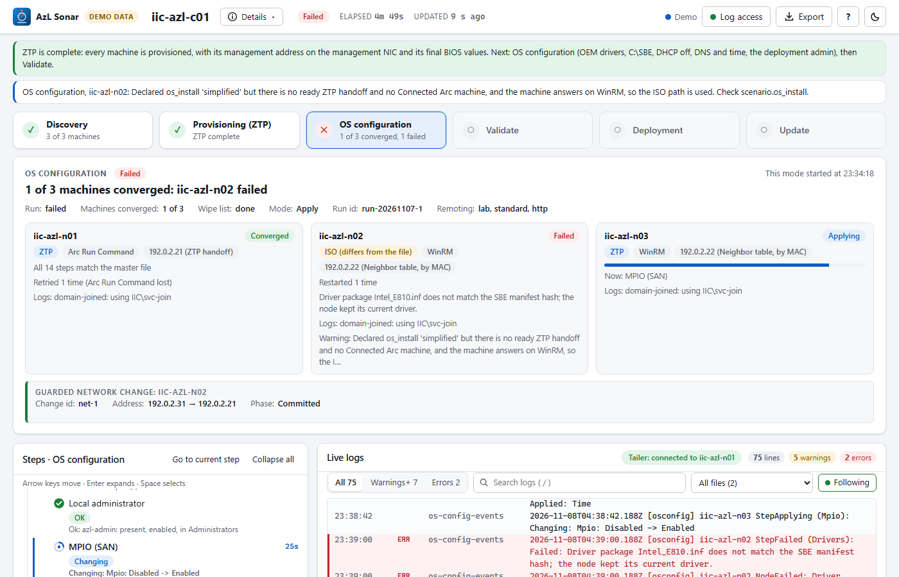

# Running Sonar, stage by stage

Sonar follows a zero-touch provisioning (ZTP) run one stage at a time. This page goes through the stages in the order [azurelocal-ztp](https://github.com/AzureLocal/azurelocal-ztp) runs them: what the stage does, **how to run Sonar for it**, what Sonar shows, what done and failed look like, and the access it needs. The stages after ZTP (OS configuration, Validate, Deployment, Update) are at the end, and the modes of the **Log access** window have [their own page](./log-access.md).

Sonar only reads. It never starts, retries or repairs a stage: ZTP does that. If you only want the commands per purpose, see [Running Sonar, by purpose](./run.md); how the ZTP event file and the edge machines are read is in [Following a ZTP run](./ztp.md).

## One command for every ZTP stage

You do not start Sonar differently for each stage. One Sonar follows the whole run, so start it once, before or during the run, and leave it open:

```powershell
Connect-AzAccount -Tenant <tenant-id>
./Start-AzlSonar.ps1 -InfrastructureFile ./infrastructure.yml          # master file, scenario.os_install: simplified
# or, with a config file:
./Start-AzlSonar.ps1 -ConfigPath ./config/clus01.json                  # provisioningRoute: simplified, ztpEvents.path set
```

Sonar reads two sources at once (see [What Sonar reads](./ztp.md#what-sonar-reads)): the **ZTP event file** (`ztp-events.jsonl`, every 2 seconds) and **Azure** (the edge machines, every `pollSeconds`). Which stage you are in decides which of the two has anything to show:

| Stage | Where Sonar sees it | What you can follow |
| --- | --- | --- |
| Resolve, Media | Event file (stage events only) | Log lines `StageStarted` / `StageCompleted` |
| Boot, Bootstrap, Vouchers | Event file | Per-machine log lines (`Mounted`, `Booting`, `VoucherWritten`, `ReadyForPortal` ...) |
| Device | Event file | A per-machine **step** and its log lines |
| Azure (claim), Ready (Install OS) | Azure (edge machines) | The machine card, the lifecycle stages and the `ProvisionOs` job as steps with **Azure** badges |
| Network | Event file and Azure | A per-machine **step** and its log lines |
| Restore | Event file and Azure | A per-machine **step** and its log lines |
| Handoff | Event file (stage events only) | Log lines; the cards read **ZTP complete** |

Start Sonar on the machine where ZTP runs (or one that can read the event file's folder). The path comes from `provisioning.simplified.evidence_path` in the master file or `ztpEvents.path` in a config file. Sonar reads the whole file when it starts, so it is safe to start Sonar late: every earlier event is shown at its own time.

**Access for all of the ZTP stages:** Reader on the resource group of the edge machines and on the managed resource group that holds their Arc machines (Reader on the subscription covers both); `Az.Accounts` signed in; read access to the event file's folder. No access to the machines is needed: when Sonar asks for the log account, cancel the prompt. There are no node logs to read yet.

The screens below use the page's own demo data (`?demo=1&route=simplified`); see the [tour](./tour.md) for each part of the page.

## Resolve and Media

**ZTP does:** Resolve finds and verifies the maintenance ISO (its version, URL and SHA-256 go in the stage's evidence). Media builds one virtual USB image per node.

**In Sonar:** two log lines each, from the file `ztp-events`: `StageStarted` and `StageCompleted` with ZTP's own evidence text. The machine cards still read *Waiting to start*. Nothing here is a step.

**Done:** the `StageCompleted` line for Resolve and for Media. **Failed:** a `StageFailed` line (level Error) with the error text. Fix it on the ZTP side and run the stage again (`-Stage Media`); Sonar shows the new attempt as more lines.

## Boot

**ZTP does:** sets the node's temporary BIOS values (for example a Fibre Channel HBA off), attaches the node's image to its BMC's virtual media, sets a one-time boot from it and restarts the node. It saves each BIOS attribute's original value, which Restore puts back later.

**In Sonar:** log lines per machine: `BiosChanged` (with each attribute), then, as ZTP's next stage begins to watch, `Mounted` and `Booting`. The card still reads *Waiting to start*: Azure does not know the machine yet.

**Done:** `StageCompleted` for Boot, the nodes show `Mounted` / `Booting`. **Stuck:** a warning line `... no change for 20 minutes` on the current state; `MediaRejected` (error) when the image is not inserted after 3 minutes or is write protected. Check the BMC and the image, then rerun `-Stage Boot`.

## Bootstrap

**ZTP does:** waits for each node to run its maintenance environment and write the ownership voucher back into its image. It reads the BMC (virtual media, power state, log entries) and the image; none of it needs a credential on the node.

**In Sonar:** the node's progress as log lines, in order: `NotStarted`, `Mounted`, `Booting`, `MaintenanceEnvironmentRunning`, `VoucherWritten`, `ReadyForPortal` (a valid voucher in hand and Azure ready to claim it). Choose `ztp-events` in the **file** filter to see only these lines; click a machine's card to see only that machine's.

**Done:** `ReadyForPortal` for every node. **Failed:** `VoucherMissing` (no valid voucher in 90 minutes) or `Failed` (the 120-minute budget ran out), both level Error and shown in red. **Warnings** (amber): no change for 20 minutes; a voucher in an image that this run did not build (the evidence says which).

## Vouchers (and the claim)

**ZTP does:** the Vouchers stage ejects the image, reads the voucher from it exclusively and writes `<media_path>/vouchers/<serial>.pem` for each node. The next stage, **Azure**, **claims** each machine: it submits the voucher to Azure, which creates the site and the edge machine.

**In Sonar:** the Vouchers stage writes only `StageStarted` / `StageCompleted` lines. The claim is visible in Azure terms: when Azure creates the edge machine, the card changes from *Waiting to start* to **Being created in Azure** (`Creating`) and the machine gets its **Azure** steps. Vouchers themselves never appear anywhere, only their SHA-256 in ZTP's lines.

**Done:** the card moves past *Waiting to start*. **Failed:** `StageFailed` on Vouchers (no voucher in 120 minutes: the error names each node's last image status) or on Azure (the claim deployment failed). Sonar needs Reader on the resource group for the edge machines, and shows nothing for them until they exist (a 404 on the edge machine call means "nothing yet", not an error).

## Device

**ZTP does:** before the claim, in the maintenance environment, through the Configurator service on port 20001, sets the static management address on the port with the management MAC (and finds the maintenance environment by scanning for that MAC when the file gives no address). It sends no host name.

**In Sonar:** a per-machine step, **Management address (maintenance environment)**, shown first in the machine's steps, even before the edge machine exists. Its events appear as children: `DeviceConfigurationSubmitted`, `DeviceConfigurationStatus`, `DeviceAddressSet`. The card says *Waiting on the node: management address* while it runs. Click the step: the live logs filter to that machine's Device events.

**Done:** the step is green with *Address set* (or *Address already set*, or *Address reported, not changed* for a DHCP, DHCP-reservation or preconfigured node). *Skipped* is normal when the node has no maintenance address: the Network stage does the job later. **Failed:** `DeviceConfigurationFailed`: the scan did not find the node, no adapter has the management MAC, or the status reported a failure. The step turns red with the text, the machine becomes an error.

## Install OS (Azure and Ready)

**ZTP does:** after the claim, Azure registers the maintenance environment, installs the operating system and connects the machine to Arc. ZTP's Ready stage waits for it (up to 180 minutes) and resubmits the `ProvisionOs` job once if it fails.

**In Sonar:** this is the part where Sonar's own Azure reads do the work. The machine card shows the lifecycle in plain words (*Being created in Azure*, *Waiting to connect to Azure*, *Registering with Azure*, *Ready to install the OS*, **Installing the OS**, *Provisioned*), the Arc connection and a progress bar. The Steps box has Azure's lifecycle stages (`ProvisionMachine`: `RegisterMachine`, `ArcEnableMaintenanceEnvironment`, `InstallExtensions`; `InstallOs`: `Initialize`, `DownloadOs`, `PrepareOs`, `RebootOs`, `InstallExtensions`, `Finalize`) and the **ProvisionOs job** with its steps, each with an **Azure** badge, status, times and error text. Click an Azure step to see what Azure says about it; the logs are left alone because an Azure step writes nothing to a node log.

**Done:** *Provisioned* on the card and the job succeeded. (With the event file, the machine then waits on Network and Restore before it is complete.) **Failed:** the card turns red with the error; Sonar treats a job error as current only while the job reports failure. After ZTP's single resubmit the earlier error moves to `previousErrors` and the machine is running again (see [previousErrors](./ztp.md#how-sonar-decides-running-success-or-failure)). On live runs error 5901 at `SetupHybridComputeRP` was the usual first-attempt failure.

## Network

**ZTP does:** after the OS install (which resets every port to DHCP), checks that the management port, found by MAC, has the file's address. It is verify-only by default: a static address that the install reset is left to OS configuration to set, and ZTP says so.

**In Sonar:** the per-machine step **Management address on the management NIC**, after the `ProvisionOs` job. The card says *Waiting on ZTP: management address check* until it ends. The states: `ManagementAddressSet`, `ManagementAddressAlreadySet`, `ManagementAddressReported` (a warning in the event file when the port does not have the expected address) and `ManagementAddressDeferredToOsConfiguration` all count as done; the step's label for the last one is *Checked; OS configuration sets the address*.

**Done:** the step is green. **Failed:** `ManagementAddressFailed` (no adapter has the MAC, or a job failed): red, with the reason. **Normal, not a problem:** a *Deferred* result with a warning line such as `... has DHCP 192.0.2.116 after the install; expected static 192.0.2.11`. OS configuration (the next step after ZTP) sets the address.

## Restore

**ZTP does:** where it set temporary BIOS values for the install, puts back the final values over Redfish, restarts the node, and waits for Arc to report a new connection and the machine to be ready again. All nodes restart at the same time on purpose.

**In Sonar:** the per-machine step **BIOS restored**, last in the machine's steps: `BiosRestoreStarted` (the attributes), then `BiosRestored` (*BIOS restored and Arc connected again*). The card says *Waiting on ZTP: BIOS restore*. During the restart the node may be unreachable and Arc reads Connected for a while (Sonar waits for ZTP's event, not for Arc alone). Without temporary BIOS values the run writes no Restore event, and once the stage is over the step reads *Not applicable: the run set no temporary BIOS values* (skipped).

**Done:** the step is green or skipped. **Failed:** `BiosRestoreFailed`: red, with the reason and the outcome per node (a node marked Restored has already restarted). Fix the BIOS or the saved original, then run `-From Restore`: a node whose BIOS is already right is left alone.

## Handoff

**ZTP does:** writes the handoff file (the Arc machine names and IDs, the installed build, each machine's management address result and restored BIOS values) and the cluster inputs for OS configuration and the deployment. It ends the run with `ZTP is done` and `Next: OS configuration`. After Handoff, ZTP writes files only.

**In Sonar:** `StageCompleted` for Handoff, and the end of the run on the page: when every machine is Provisioned, its Network step succeeded and its Restore step succeeded or is not applicable, each card reads **ZTP complete** with *Next: OS configuration*, the Provisioning tile reads *ZTP complete*, and the summary says "ZTP is complete: all N machines are provisioned. Next: OS configuration". A link under the header opens the OS configuration guide.

**What to do:** nothing in Sonar. ZTP's job is over. Start OS configuration (OEM drivers, `C:\SBE`, DHCP off, DNS and time, the deployment admin), then Validate. Sonar stays at **ZTP complete** until the OS configuration run starts and writes its events (the **OS configuration** mode takes over), then Validate.

## Discovery

The first stage of the flow, **before ZTP**: the toolkit's `Invoke-HardwareDiscovery.ps1` reads every node's Dell iDRAC (Redfish, read only) and writes, in its `-OutputPath` folder, one `<ServiceTag>.json` per node and `discovery-summary.json` (written after the last node). Sonar follows that folder (`discoveryPath`; with the master file it is the `discovery` folder inside `provisioning.simplified.evidence_path`). It reads the files, never an iDRAC, and parses a file again only when it changes.

Per machine the page shows the **service tag** (the serial number ZTP maps the ownership voucher by), the model and BIOS version, the iDRAC MAC, every network port with its MAC and link state, the **suggested management port** (and whether it is confirmed or only a guess), and the **BOSS card** (drives, and whether a virtual disk exists; a card without one gets it from the toolkit's Phase 02 Task 01 before the OS install). Anything to check before ZTP is listed under the machine.

| State | Meaning |
| --- | --- |
| *Waiting* (grey) | `discoveryPath` is set and the folder is not there yet, or it is there with no discovery file. |
| *Running* | Some machines are read and `discovery-summary.json`, which the toolkit writes last, is not there yet. |
| *Failed* | A file cannot be read (it is named), or the summary is there and a machine has no record (the run reported it as failed). |
| *Done* | Every machine has a record and the summary is there. Machines with something to check say *Check*. |

Without `discoveryPath` the Discovery tile is grey and its hover text says how to get its data. While Discovery is the only stage with anything to show, the page opens on it; once ZTP (or OS configuration) starts the page follows that. For a **manual install** the next step is OS configuration, not ZTP (below).

### A manual install (no ZTP)

When the master file says `scenario.os_install` is not `simplified` (the OS is installed from an ISO, by hand), Sonar does not monitor the install. The **Provisioning** tile reads *Not used: manual install* in a neutral state (no progress, no *Waiting*), the steps box says so, all ZTP wording is hidden for the run, and the page opens on **OS configuration** (on Discovery first when discovery data exists). Each machine row of OS configuration still shows its method (ZTP or ISO), transport and address source as extra detail. With `scenario.os_install: simplified` everything is as before.

## OS configuration



**The toolkit does:** [azurelocal-toolkit's](https://github.com/AzureLocal/azurelocal-toolkit) `Invoke-AzureLocalOsConfiguration.ps1` configures the operating system of every node after ZTP (or an ISO install) and before Validate: remote management, the management address, DNS, time, the computer name, the domain join, unused adapters, the local administrator, MPIO and the SAN checks, the storage wipe, the SBE package and the OEM drivers, and, for an ISO machine, the Azure Arc registration. It plans first (read only), applies node by node and then proves each node matches the master file. While it runs it appends what it does to the OS configuration event file, `os-configuration-events.jsonl` (the feed is described in the toolkit's [OS configuration guide](https://github.com/AzureLocal/azurelocal-toolkit/blob/main/docs/os-configuration-and-arm-deployment.md#the-event-feed-what-the-run-tells-a-viewer)).

**How to run Sonar for it:** point Sonar at that file and start it where the file is (or where its folder is shared).

```powershell
Connect-AzAccount -Tenant <tenant-id>
./Start-AzlSonar.ps1 -InfrastructureFile ./infrastructure.yml
```

### The event feed Sonar reads

One JSON object per line (`timestamp`, `node`, `stage`, `step`, `state`, `evidence`, `level`, `nextAction`, `method`, `transport`, and from the toolkit's hardened feed `runId` and `seq`). `osConfigEventsPath` can be one file, a **folder** (every `*.jsonl` in it, oldest first: the toolkit's one file per run) or a **pattern** such as `os-configuration-events*.jsonl`.

- **Runs.** The newest run id is the current run and the page shows it under the headline. A new run id starts over (the machines of the earlier run go); a late line of an earlier run is ignored and counted (*Older run, ignored*). Lines are ordered by `seq`, a repeated `seq` is dropped, and a late `NodeStarted` does not throw away the events already held. A file with no `runId` is one legacy run, read as before.
- **Every state is shown.** Run: `RunStarted`, `PlanCompleted`, `WipeListPublished`, `WipeListApproved`, `WipeListRejected`, `RunCompleted`. Node: `NodeStarted`, `MethodResolved`, `TransportResolved` (the address and where it came from), `NodeRetry`, `NodeRestarting`, `NodeReconnecting`, `NodeReconnected`, `NodeWaiting` (the heartbeat: what the host waits for, the phase and the seconds), `NodeConverged`, `NodeFailed`, `NodeBlocked`. Step: `StepPlanned`, `StepSkipped`, `StepApplying`, `StepApplied`, `StepFailed`, `StepVerified`. Domain join: `DomainJoinPlanned`, `DomainJoinApplying`, `DomainJoined`, `DomainAdminsConfigured`, `DomainJoinFailed`. Guarded network change: `NetworkChangeStaged`, `NetworkChangeVerifying`, `NetworkChangeAwaitingConfirm`, `NetworkChangeCommitted`, `NetworkChangeRepaired`, `NetworkChangeRolledBack`, `NetworkChangeRefused`. Remoting: `RemotingProfileResolved`, `RemotingFirewallChange`, `RemotingListenerChange`, `RemotingBootstrap*`, `TrustedHostsChanged`, `TrustedHostsRestored`; also `StaleRunCommandDeleted`. Each has a label, a status and a message (its evidence). A state this Sonar does not know is **shown, never dropped**: in the machine's newest events marked as not known, under *States not known to Sonar* and in the log pane. Fields Sonar does not know are ignored.
- **Guarded network change panel.** Under the cards: the change id, the old and new address, the phase, the deadline with a countdown while the node waits for the confirmation, the rollback or refusal reason and the node's verdict.
- **Node address.** Each card shows the address the run reaches the machine on and how it was found: *override*, *ZTP handoff*, *Azure Arc machine*, *infrastructure file* or *neighbor table by MAC* (from the `TransportResolved` event's `addressSource`, or `found by <source>` in its text; a source Sonar does not know is shown as written, none as *source not reported*).

Unverified against a live run: the field names above come from the toolkit's source (`AzlOsConfigurationEvents.psm1`, `AzlGuardedChange.psm1`, `AzlDomainJoin.psm1`, `AzlRemotingSession.psm1`) and its design document, not from a recorded run; `runId`, `seq` and `addressSource` are the hardening work in progress.

With the master file the file is `<provisioning.simplified.evidence_path>/os-configuration-events.jsonl`, next to `ztp-events.jsonl`. If the toolkit run was given `-EventLogPath`, or you use a config file, set [`osConfigEventsPath`](./config.md) (`Set-AzlSonarConfig -Key osConfigEventsPath -Value <file>`). Sonar tails the file every 2 seconds, read-only. Without it the **OS configuration** tile stays grey and says how to get the data.

**In Sonar:** the **OS configuration** tile (between **Provisioning** and **Validate**), the **OS configuration** mode and its lines in the log pane (file `os-config-events`, each tagged `[osconfig]`).

- **The summary box.** The run in one sentence (*1 of 3 machines converged*), then the run state, the machines converged, the wipe list (*pending* until the listed machines have cleared their storage) and the mode (Plan or Apply). One card per machine: its name, a state chip, the method chip and the transport, the step it is on, the retries and restarts, the account that reads its logs and any warning.
- **The Steps box.** One row per machine with its method, transport, versions and the guarded network change; under it, its steps in the order the toolkit runs them: remote management, network, DNS, time, computer name, domain join, unused adapters, local administrator, MPIO, SAN verification, clear storage, SBE package, OEM drivers and Azure Arc registration. Each step has a stage chip and the toolkit's own text: what it found and, for a change, *current -> desired*. A click on a step shows only that machine's lines for that step in the log pane. A step that runs as an Arc Run Command carries the **Azure** badge; under the machine, Sonar shows the run command it reads from Azure (`machines/{name}/runCommands`, read-only) with its state and age, and warns when one has been *Creating* for more than 10 minutes.

**What the stages mean.**

| Stage | Meaning |
| --- | --- |
| *Waiting* | The run has not reached this step on this machine. |
| *Planned* | The plan found a difference (`StepPlanned`, action Change); the *current* and *desired* values are in the text. Nothing was changed. |
| *OK* | The plan found nothing to change. |
| *Changing* | The apply is changing it now (`StepApplying`). |
| *Applied* | The apply reports it done (`StepApplied`); the verification pass has not confirmed it yet. |
| *Verified* | The verification pass found the step matching the master file (`StepVerified`). |
| *Failed* | The apply or the verification pass failed on it (`StepFailed`), with the toolkit's reason. |
| *Blocked* | The plan cannot go on without you (for example leftover storage with the wipe off). |
| *Not applicable* | The step does not apply, with the reason (*not selected with -Step*, *no SBE bundle*, *the storage wipe is off*, *the identity design is local*). |
| *Verify only: OK* | ZTP did this step (the computer name, the Azure Arc registration); the run checks it and does not change it. |

A machine is **converged** when the toolkit reports `NodeConverged` for it. The mode is **ready** when every machine has converged: the tile reads *3 of 3 converged* and the summary says *Next: Validate*. It is information only: Sonar blocks nothing, and **Provisioning** never stays *running* because of OS configuration. Validate says it starts after OS configuration has converged on every machine.

**Which method, which versions.** Each machine says how it was installed: **ZTP** (provisioned by simplified machine provisioning) or **ISO** (installed by hand). Before the run has resolved it, Sonar shows the method it expects (from `scenario.os_install` and from whether ZTP events exist for the machine) marked *expected*. When the declaration and the evidence disagree the chip says *differs from the file* and a warning names both; the evidence wins, as it does in the toolkit. The step list follows the method: on a ZTP machine the computer name and the Arc registration are *verify only*, on an ISO machine they are real steps. A mixed cluster shows both side by side. The machine row and **Details** show the versions the toolkit reported: the OS (caption, version, build) and the computer name the node reported, the SBE (publisher, family, version, package and how it reaches the node), the master file's `schema_version` and the toolkit's own version, and the transport (Arc Run Command or WinRM, per machine and per step).

**The guarded network change.** Changing the management address can cut a node off, so the toolkit applies it as a *commit confirmed* change: the node snapshots itself, applies, checks itself, and reverts on its own unless the orchestrator confirms in time. Sonar shows it on the **Network** step and the machine: *Staged*, *Checking the node* (`NetworkChangeVerifying`), *Waiting for the confirmation* (`NetworkChangeAwaitingConfirm`, with the time left in the window, ten minutes by default), *Committed*, *Repaired* (with the repair rung) and, when it did not hold, *Rolled back* or *Refused* with the **reason the node gives**. A rolled-back or refused change turns the machine red; read the reason, fix the address, the gateway or the VLAN, and run the OS configuration again.

**The domain join and the account for the logs.** In an Active Directory design the `DomainJoin` step joins each node to the domain after its name, network, DNS and time (`DomainJoinPlanned`, `DomainJoinApplying`, `DomainJoined`, `DomainAdminsConfigured`, or `DomainJoinFailed` with the AD error text). Sonar reads a node's logs with the local account (`identity.local_admin`, for example `azl-admin`) until the node has reported both `DomainJoined` and `DomainAdminsConfigured` (the step that adds the domain administrators to the node's local Administrators: before that a domain account cannot read the logs). In between the card says *joined, waiting for domain administrators*. After both, Sonar uses the domain account you supply, `NETBIOS\username` from `identity.active_directory.domain_join_account` (never the LCM user), its password read from the Key Vault reference in the file. If a node refuses the domain account, Sonar stops using it for **every** node (a wrong password counts towards the domain's lockout threshold), goes back to the local account and warns; it tries again once, after a back-off, and stops for good after two rejections until the password changes. See [the lockout circuit breaker](./log-access.md#the-lockout-circuit-breaker). The account in use and why (*domain-joined: using IIC\svc-join*, *workgroup: using azl-admin*) is on each card, in the Log access window and in **Details**; the password is never shown. See [Log access](./log-access.md#which-account-reads-which-node-local-first-then-the-domain-account).

**Done:** every card reads *Converged* and the tile is green. **Failed:** a machine reads *Failed*, *Blocked*, *Rolled back* or *Refused*, the tile turns red and the summary names the machine. **Retrying, not a problem:** an Arc Run Command that ends in state `Unknown` (the node's agent lost its connection, for example while its network changes) is run again up to three times; the card says *Retrying* and counts the tries, and the verification pass decides the outcome, not the command's status.

**What to do when a step is stuck.**

1. Open the machine's steps. The step in *Changing* is the one running; its time is the time since it began. A step that has run much longer than its neighbours is the one to look at.
2. Look under the machine for the **run command** line. *Creating* for more than 10 minutes means Azure has not handed the command to the node's agent: check that the machine is *Connected* in Azure Arc, and that nothing blocks its outbound connection. A run command that is *Running* for long can simply be a long step (the SBE package, the drivers).
3. Read the lines of that step in the log pane (click the step). A `NodeRetry` line says the command was lost and is being tried again; three of them in a row end in the verification pass, which reads the node again.
4. If the step failed, the card and the step carry the toolkit's reason. Fix the cause on the node, then run `Invoke-AzureLocalOsConfiguration.ps1` again: steps that are already right are not repeated.
5. If the run itself died (no `RunCompleted` line, the last event is old), the machines stay where they were. Start the toolkit run again; its next `RunStarted` clears the machines it names and the page follows the new run.

## Validate and Deployment: the toolkit run

**The toolkit does:** `Invoke-AzureLocalArmDeployment.ps1` checks the instance (read only), generates the ARM parameters, submits Validate, waits, asks for approval, submits Deploy and waits, and appends every step to `arm-deployment-events.jsonl`.

**In Sonar:** the **Validate** and **Deployment** tiles and modes. Before Azure has steps of its own the tiles follow the toolkit (*Checking*, *2 checks failed*, *Step 0.4*, *Failed at 0.41.2*); the Steps box lists the checks (failures first) and the validation results or the deployment progress per step with its duration; a failure that matches the toolkit's known-issues list carries a hint, for example the device-ID Arc name problem at step 0.41. Set [`armEventsPath`](./config.md) when the toolkit run used its own report directory. The full description, the states and what Sonar never does are on [Validate and Deploy from the toolkit](./arm-run.md).

## After ZTP

| Next step | In Sonar | How to run it |
| --- | --- | --- |
| **OS configuration** | The **OS configuration** mode: a card per machine, its steps, the method and versions, the guarded network change and the domain join. | The toolkit's `Invoke-AzureLocalOsConfiguration.ps1`, with Sonar pointed at its event file (`osConfigEventsPath`). [Details](#os-configuration). |
| **Validate** | The **Validate** mode: the toolkit's checks and validation results ([ARM run](./arm-run.md)), Azure's validation steps (`deploymentSettings`), the running step with a live timer, errors expanded. Node logs from the seed node. | `./Start-AzlSonar.ps1 -InfrastructureFile ./infrastructure.yml -Credential (Get-Credential)` with the deployment local admin. [Details](./run.md#watch-validate). |
| **Deployment** | The **Deployment** mode: the toolkit's progress per cluster step with the known-failure hint ([ARM run](./arm-run.md)), the nested step tree, the live logs, the account and folders in **Log access**. | The same command. [Details](./run.md#watch-a-deployment). |
| **Update** | The **Update** mode: the update run's steps. | `track: update`, or `auto` when Azure reports an update. [Details](./run.md#follow-an-update). |
| **Deployed cluster** | The **Deployment** mode in its *Done* state, with a card per machine that keeps its Arc status. There is no Health mode. | Any run on a deployed cluster. [Details](./run.md#look-at-a-deployed-cluster). |

A machine that fails in any stage turns red, the status chip reads **Failed**, and the page stays on the mode that failed so you can read the text.

## Running without a deployment: demo and replay

Neither needs Azure or a node. Use them to learn the page or to review a finished run, stage by stage.

```powershell
./Start-AzlSonar.ps1 -Replay ./recordings/clus01.jsonl -Speed 240 -StartAt deployment
```

Or open `http://localhost:8642/?demo=1&route=simplified` on a running Sonar for the built-in three-machine ZTP sample (`route=oem` for the OEM image route, `?demo=1` for a deployment, `?demo=1&replay=1` for the replay bar). A replay has a transport bar (play, speed, scrubber with markers, jump to a phase); see [Record and share a session](./run.md#record-and-share-a-session).
