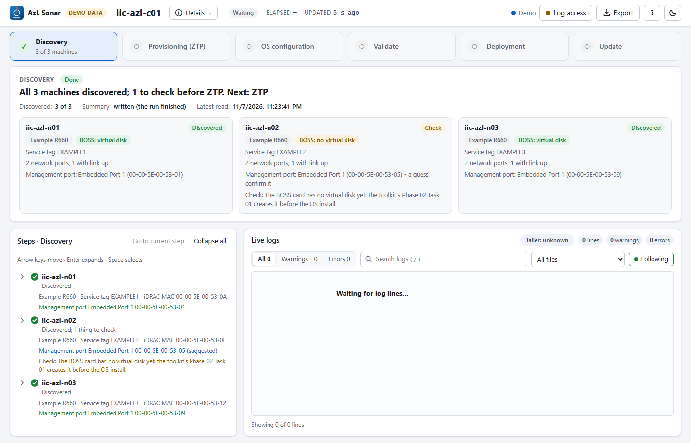
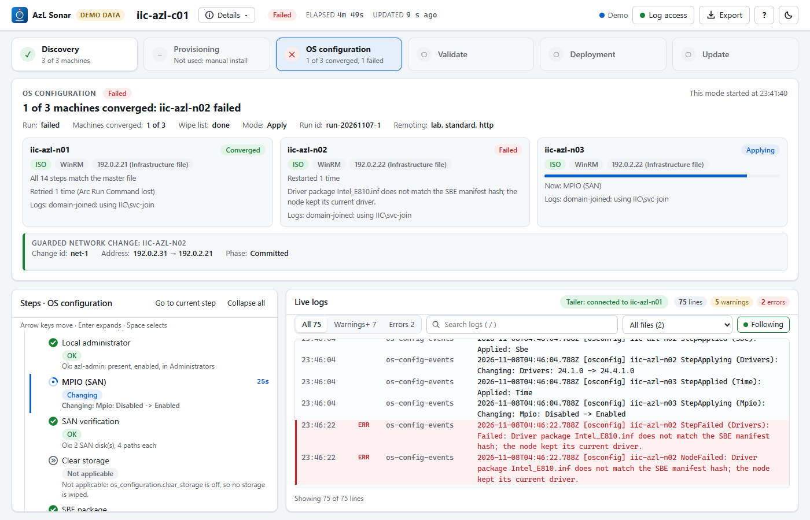
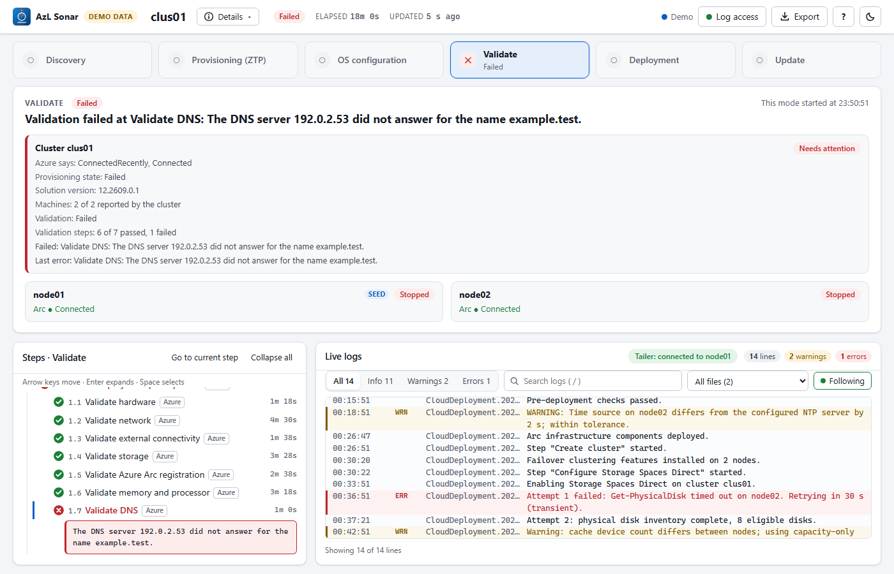
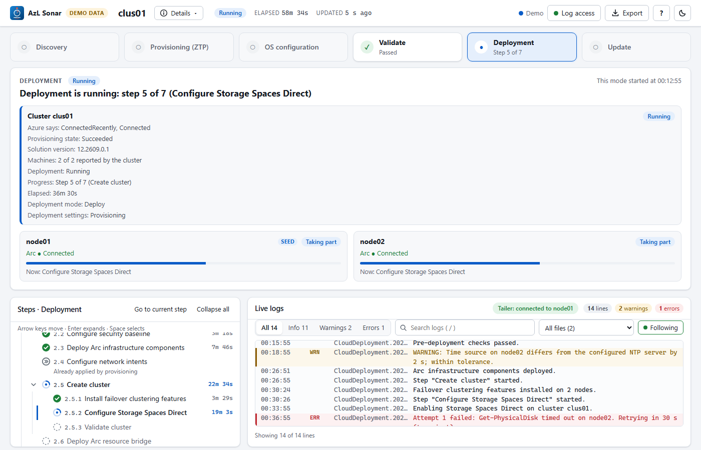
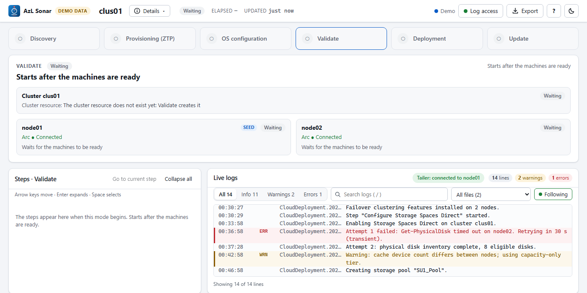
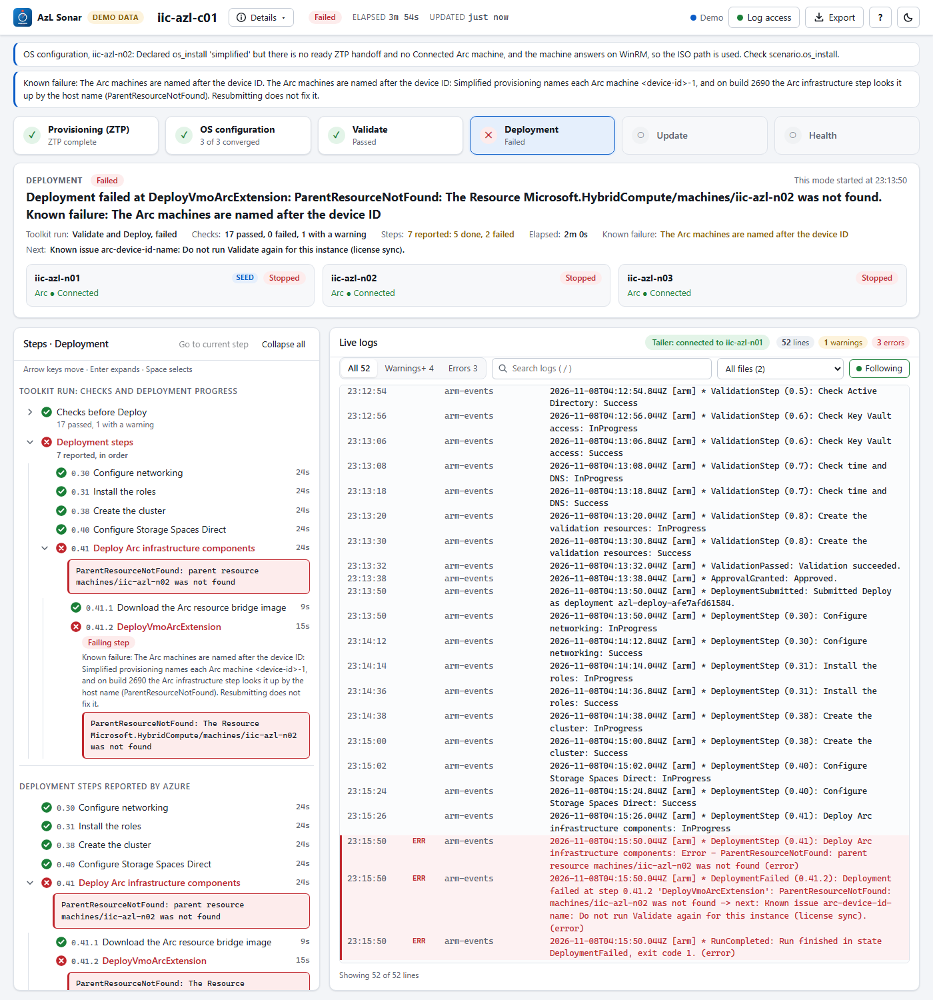

# Tour of the page

What is on the page, top to bottom. The screenshots are Sonar's own demo data (`?demo=1&route=simplified`: three machines of a ZTP run, example names only). Everything on the page is read-only.

## The top bar

From left to right: the brand, the **cluster name**, the **ⓘ Details** button, the run status, then on the right the connection state, **Log access**, **Export**, the **?** button and the theme toggle.

- **Status.** A chip (*Running*, *Done*, *Failed*, *Waiting*), the **Elapsed** time since the first machine or step started, and **Updated N s ago** (when Azure last answered; it turns amber when the answer is late).
- **Connection.** *Live* (server-sent events), *Polling*, *Offline, retrying*, *Demo* or *Replay (not live)*.
- **Log access** opens the [Log access window](#log-access-window). The dot says how the node logs are read: **green** live from the seed node, **amber** Azure only (the node logs are not available), **red** nothing answers.
- **Export** downloads the whole run as one JSON bundle (hidden in a replay).
- **?** opens the Help box ([below](#help-box)). The sun/moon button switches the light and dark theme; the choice is remembered in this browser.

## Details: what Sonar collected and is using

The **ⓘ Details** button opens a pop-down that answers "what is Sonar actually working from?". Each value shows where it came from and how old it is.

| Group | What it shows |
| --- | --- |
| **Target** | Cluster, resource group (with a copy button), the subscription as its first 8 characters only, the region. |
| **Mode** | The route (simplified provisioning, ZTP, or OEM image + Arc registration) and the identity model, with one line on what it means. |
| **Nodes** | Each machine's name and address, and which one is the seed node (the node whose logs are read). |
| **Sources** | How often Sonar reads Azure and when Azure last answered; the ZTP event file with its event count and the age of the last event; whether the node logs are live. |
| **Config** | Which file Sonar read (`infrastructure.yml` or the config file), when, and how often it is checked; **Not set** items with the key to set; the Sonar version. |

Secrets are never shown: a credential appears only as *set* or *not set*, and the subscription id only as its first 8 characters. The same data is served at `/api/details` (read-only, this machine only).

## The modes

The row under the top bar has one tile per mode: **Discovery**, **Provisioning (ZTP)**, **OS configuration**, **Validate**, **Deployment**, **Update**, six equal tiles. **Add node** and **Repair** have a tile of their own when the run is one of them. There is no Health tile: the machine cards show each machine's Azure Arc status in every mode, and a finished deployment is the Deployment tile in its *Done* state. Each has a status icon (✓ done, a pulsing ● running, ○ waiting, – not used, ✕ failed), the name and a state line such as *2 of 3 machines ready*, *Step 3 of 7*, *Done* or *Passed*.

- The tile of the mode that is happening now is selected when the page opens. Click any tile to look at another mode: the summary box and the Steps box switch to it.
- A tile that has not started is grey and has no state line. Hover it to see when it starts (*Starts after validation passes*).
- **OS configuration** sits between Provisioning and Validate. It shows *2 of 3 converged* (and *1 retrying*) while the toolkit's run works, turns red when a machine fails, and is green only when every machine has converged; a finished plan with changes pending reads *Plan ready* and stays grey. Without `osConfigEventsPath` it is grey and the hover text says how to get its data. The page opens on it once ZTP is complete and an OS configuration run has started. [What it shows](stages.md#os-configuration)
- **Validate** and **Deployment** follow the toolkit's ARM run while Azure has no steps of their own: *Checking*, *2 checks failed*, *Step 0.4 · 3m*, *Failed at 0.41.2*. Without `armEventsPath` (or the master file's default report directory) they show only what Azure reports. [What it shows](arm-run.md)
- **Discovery** comes first, before ZTP: the toolkit's hardware discovery (service tag, ports and MACs, suggested management port, BOSS card per machine), read from `discoveryPath`. Grey without it. The page opens on it while it is the only stage with anything to show. [What it shows](stages.md#discovery)
- For a manual install (the master file's `scenario.os_install` is not `simplified`) the Provisioning tile reads *Not used: manual install* and is neutral; the page opens on OS configuration. [Details](stages.md#a-manual-install-no-ztp)
- Started with `-Monitor <stage>`, Sonar shows that tile only; the others are hidden, not greyed. [Run one stage on its own](run.md#run-one-stage-on-its-own-monitor)
- There are always six tiles in a normal run. On the OEM image route the first tile reads **Provisioning (OS image)** instead of *Provisioning (ZTP)*. A run Sonar joined after provisioning has no machine data: the first tile is grey and its hover text says so (Sonar cannot tell whether provisioning was done, so it does not tick it).

The first screenshot is the demo `?demo=1&route=discovery`, the second `?demo=1&route=iso`.

## The cluster card

Validate, Deployment, Update, Add node and Repair act on the **cluster**, not on one machine, so their summary has a **cluster card** above the machine cards. Discovery, Provisioning and OS configuration stay per machine.

The card shows the cluster name and what Azure says about the cluster resource (*status, connectivity*, *provisioning state*, *solution version*, *machines* the cluster reports), then what the mode adds at cluster level:

| Mode | The card adds |
| --- | --- |
| **Validate** | The validation result (*Passed*, *Running*, *Failed*), *N of M steps passed, K failed* with the **failed steps first**, and the toolkit's check counts when its ARM run is followed. |
| **Deployment** | The result, *Step n of m (the step running)*, the **elapsed time**, the deployment mode and the deployment settings' state. |
| **Update** | The update state (*Update available*, *Preparing*, *Installing*, *Failed*, *Needs attention*), the **current and target version** and the failed health checks. |
| **Add node**, **Repair** | The operation, and that Azure does not report its target; the machines that are not connected are named. |

Every card ends with the **last error** when there is one. Before the cluster exists (Validate creates it) the card says *The cluster resource does not exist yet*. **Click the card** to show only the cluster-level steps (the machine rows of Validate go) and clear the machine filter; click it again to clear. The card is read from one extra read-only request for the cluster resource; the rest was already in the page. It is built from the Microsoft Learn REST reference (clusters, 2026-10-01) and is unverified against a live run. The screenshot is the demo `?demo=1&route=cluster`.

## The summary box

The title and status chip of the selected mode, one sentence that says where things stand (and, when something blocks, what), when the mode started, and **a card per machine**.

A card shows the full machine name, its state in plain words (Azure's raw value is in the tooltip), the Azure Arc connection, a progress bar while it runs, and the one thing it waits on, or **Next: OS configuration** when ZTP is done. **Click a card** to look at that machine only: the steps and the logs follow it. Click it again to clear.

## Steps

The steps of the selected mode, with a short description under every step name. In the provisioning mode they are grouped per machine. Steps that run in Azure carry an **Azure** badge.

- **Click an Azure step** (for example *RegisterMachine* or *InstallOs*): its status, start and end, what Azure says and any error are shown under it. The logs are left alone, because an Azure step writes nothing to a node log.
- **Click a node step** (the ZTP stages *Management address*, *Management address on the management NIC* and *BIOS restored*; the OEM image route's *OS image update* and *Bootstrap*; the deployment steps): the live logs filter to that machine and that step. For a ZTP stage the logs show the ZTP event lines of that stage; for the other node steps, the step's time window.
- **Go to current step** jumps to the step that is running (switching mode if needed); **Collapse all** folds the tree.

## Live logs

The live log pane has the **All / Info / Warnings / Errors** filter (each button shows only its own lines: *Warnings* never includes errors; click several to combine them, *All* clears the choice), the search box (press `/` to focus it; matches are highlighted), the file filter, the line, warning and error counts, one chip with a × for each filter that is on, a **new lines ↓** button while you are scrolled up, **Follow**, and the status line *Showing N of M lines*.

When a filter shows nothing, the pane says why. A step that has produced no lines yet says so (*This step has produced no lines on this node yet*) and offers **Show all lines for this node** and **Clear filter**.

## Log access window

The **Log access** button opens a window with everything about reading the node logs: the identity, the status line (*Log access: Tailing node …, as supplied, last line 4 s ago*), and one tab per phase (Provisioning, Validation, Deployment, Post-deployment, Update, Add node, Repair, with *(current phase)* on the active one). For each phase: **Account**, **Where** (every folder), **When**, **How**, **This deployment**, **Confidence** and **Source**. Confidence says whether the entry was confirmed on a live deployment; if the logs are not where an unconfirmed entry says, please open an issue on GitHub. Close it with **Close**, `Esc` or a click outside.

## The OS configuration mode

Between Provisioning and Validate. Below the cards a **guarded network change** panel shows, per machine that has one: the change id, the old and new address, the phase, the deadline with a countdown while it waits for the confirmation, and the rollback reason. Each card also shows the address the run reaches the machine on and where it came from (override, ZTP handoff, Azure Arc machine, infrastructure file or the neighbor table), the heartbeat while the host waits, and the newest events, with any state this Sonar does not know shown as such. The facts under the headline name the current run id and how many lines of an older run were ignored. The summary has a card per machine: the method chip (**ZTP** or **ISO**, *expected* until the run resolves it, *differs from the file* with a warning when the master file says otherwise), the transport, the step it is on, *Retried* and *Restarted* counts, the account that reads its logs, and, during a guarded network change, the time left to confirm. The Steps box has the machine's steps with a stage chip each (*Planned*, *OK*, *Changing*, *Applied*, *Verified*, *Failed*, *Blocked*, *Not applicable*) and the toolkit's text; the **Azure** badge marks a step that runs as an Arc Run Command. **Details** lists the method, transport and versions of every machine. The full description is [here](stages.md#os-configuration). The screenshot is the demo (`?demo=1&route=osconfig`).

## The Validate and Deployment modes (ARM run)

The summary has the run in one sentence and its facts: the checks, the steps reported, the elapsed time, the known failure and the next action. The Steps box starts with the toolkit's checks (failures first) and the deployment steps in order with a duration each; the failing step carries the hint for the known failure. **Details** lists the run, the template and the state of each phase. The full description is [here](arm-run.md). The screenshot is the demo (`?demo=1&route=arm`).

## Help box

The **?** button shows the Sonar version, links to the documentation (running Sonar stage by stage, updating the config, troubleshooting) and the GitHub repository, and the license. The version and the links come from the Sonar back end.

## Dark theme and narrow screens

The theme follows the system setting until you pick one with the toggle. On a screen under 900 px the tiles use two columns, the summary, the steps and the logs stack, and the page scrolls; the steps and the logs keep a fixed height and scroll inside.

